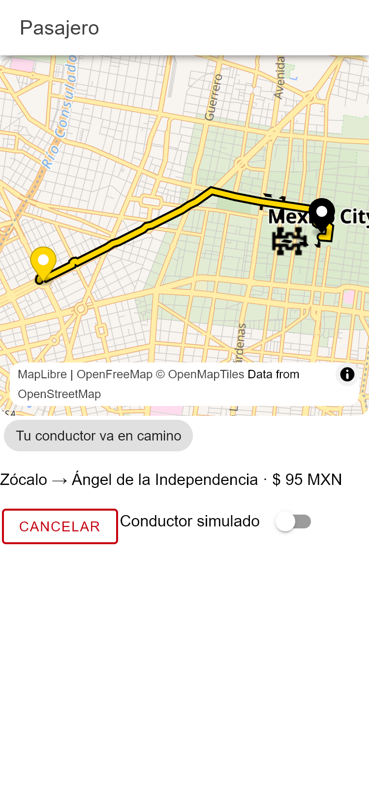
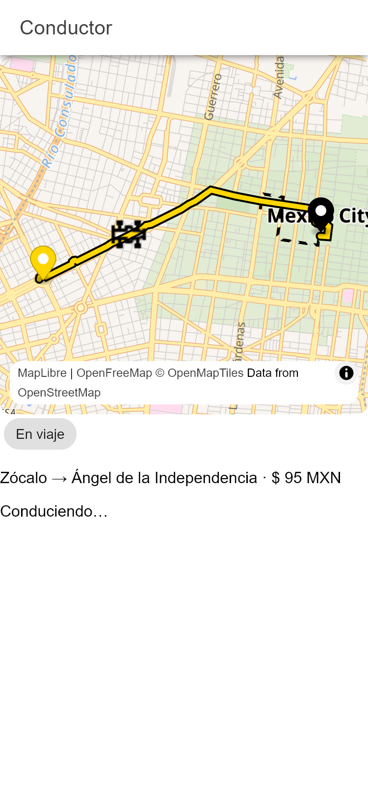

# Traslados

Demo de viaje en vivo entre un pasajero y un conductor. Es la app del conductor de las estadías de 2021 (sigue intacta en la rama `master`), rehecha aquí como primer paso de "Traslados".

| Pasajero en camino | Conductor en viaje |
|---|---|
|  |  |

## Antes (`master`) y después (rama `traslados`)

| | Antes (2021) | Después |
|---|---|---|
| Stack | Angular 12, Ionic 5, Cordova 9, AngularFire 6 / Firebase 8 | Angular 22, Ionic 9, Capacitor 8 (solo `capacitor.config.ts`), Vitest, Playwright |
| Mapa | Google Maps con la llave en el repo | MapLibre GL + OpenFreeMap, sin llaves |
| Aceptar un viaje | Escritura directa: dos conductores podían tomar el mismo viaje | Transición validada y transaccional (`navigator.locks`): uno gana, el otro recibe "Este viaje ya lo tomó otro conductor" |
| Si falla la ruta | El viaje se perdía | Las rutas viajan dentro del viaje y se precalculan (OSRM) |
| Estados | Sin máquina de estados explícita | Máquina de estados pura y probada (`estado.ts`) |
| Pruebas | Solo las pruebas de plantilla (Karma / Protractor) | 16 pruebas Vitest y 2 e2e de dos pestañas |

## Cómo correrla

```
npm install
npm start
```

Abre `http://localhost:4200/pasajero` y `http://localhost:4200/conductor` en **dos pestañas del mismo navegador**, o en `/pasajero` activa el interruptor "Conductor simulado". Con `?vel=N` cada tramo (20 s) dura N veces menos.

## Pruebas

- `npm test`: Vitest, una sola corrida (máquina de estados, rutas y almacén).
- `npm run e2e`: Playwright con el Chrome instalado (`channel: 'chrome'`; no hace falta `playwright install`). Levanta `ng serve --port 4310` y prueba, con dos o tres páginas en un mismo contexto, el viaje completo y la carrera de dos conductores aceptando a la vez.
- `node e2e/capturas.mjs` (con `ng serve --port 4310` corriendo) regenera las capturas de `docs/capturas/`.

## Arquitectura

- `src/app/viaje/estado.ts`: dominio puro (estados, `puedeIr`, `transicion`), sin Angular.
- `AlmacenViajes` es una interfaz; el único adaptador es `AlmacenMemoria` (localStorage + BroadcastChannel + `storage` + `navigator.locks`).
- Mapa con MapLibre GL y el estilo de OpenFreeMap; el worker de maplibre se copia a assets (ver `angular.json`).
- Rutas OSRM precalculadas en `src/app/viaje/rutas-semilla.json` (`node scripts/generar-rutas.mjs` las regenera); la app nunca llama a OSRM.
- Capacitor configurado, sin plataformas android/ios todavía.

## Límites conocidos

- El estado vive en localStorage y crece con cada viaje; no se limpia.
- Recargar la pestaña del conductor reinicia el tramo en curso desde su inicio.
- El conductor simulado solo atiende el viaje de su propia pestaña.
- localStorage es el almacén de una demo en un solo navegador: no sustituye a un servidor.

## Pendiente

- Siguiente rebanada: adaptador de Firestore con reglas probadas en el emulador.
- Fuera de alcance: push, invitaciones, cuentas y pagos.
