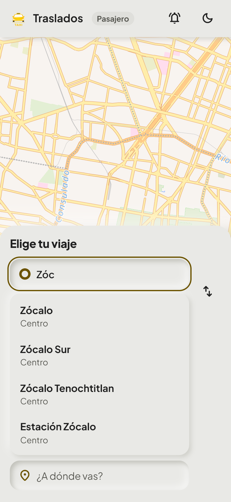
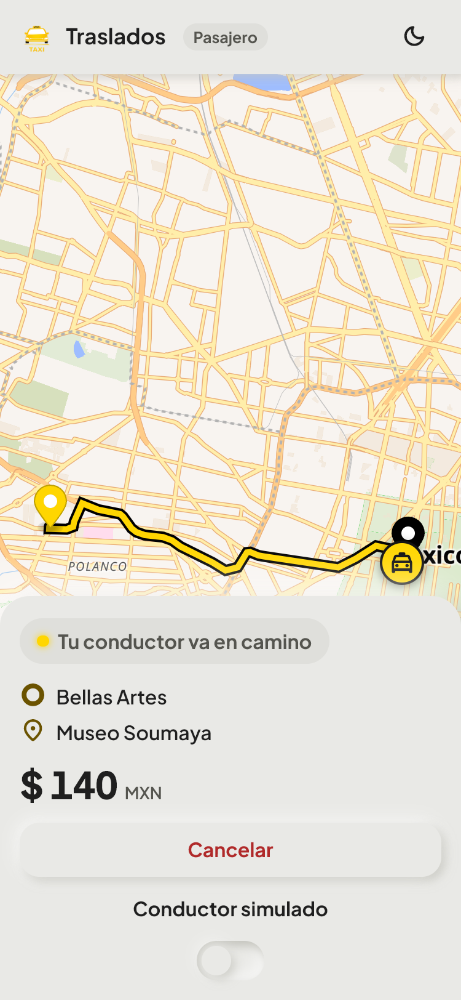
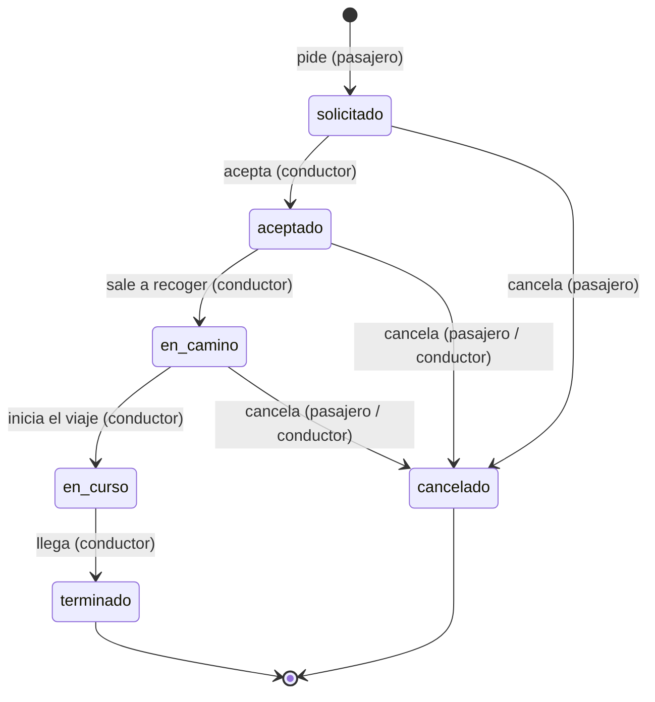
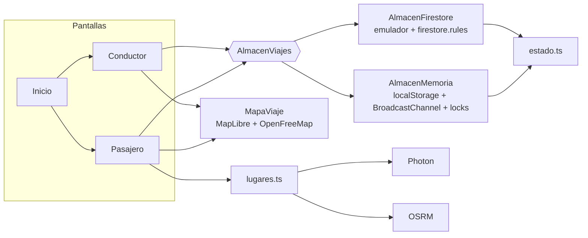

# Traslados 🚕

Viaje en vivo pasajero ↔ conductor: mapa, máquina de estados y aceptación transaccional. Rediseño de una app de mis estadías (2021).


-FFCA28?logo=firebase&logoColor=black)


<p align="center">
  
  
  
</p>

## Qué hace

- Eliges origen y destino escribiendo (sugerencias desde la tercera letra) o tocando el mapa. También hay tres viajes rápidos que llenan todo al instante.
- Ves la ruta de vista previa, los km, los minutos y el precio estimado antes de pedir.
- El conductor recibe las solicitudes en vivo, con aviso sonoro y vibración en celulares.
- El pasajero sigue el coche en el mapa mientras se acerca y durante el viaje.
- Si dos conductores aceptan a la vez, solo uno gana. El otro ve "Este viaje ya lo tomó otro conductor".
- Tema claro y oscuro, y diseño responsivo de celular a escritorio.

## Lo interesante (ingeniería)

- **Máquina de estados pura y probada.** `estado.ts` no depende de Angular: decide quién puede pasar un viaje de un estado a otro y por qué no.
- **Puerto `AlmacenViajes` con dos adaptadores.** `AlmacenMemoria` (localStorage entre pestañas, con `navigator.locks`) y `AlmacenFirestore` (`runTransaction`). Mismo código de pantallas, otro almacén.
- **Reglas de Firestore que validan transiciones**, con 12 pruebas contra el emulador.
- **e2e de dos y tres pestañas**, incluida la carrera de dos conductores, en memoria y en el emulador.
- **Sin llaves.** OpenFreeMap, Photon y OSRM son públicos. El proyecto `demo-traslados` lleva el prefijo `demo-`, que impide tocar uno real.
- **Sonidos y animaciones sin assets.** Los sonidos se sintetizan con Web Audio. Las animaciones usan View Transitions y respetan `prefers-reduced-motion`.

## Diagramas

### Estados del viaje



### Arquitectura



## Antes y después

Antes: rama `master` (2021). Después: rama `traslados`.

| | Antes (2021) | Después |
|---|---|---|
| Stack | Angular 12, Ionic 5, Cordova 9, AngularFire 6 / Firebase 8 | Angular 22, Ionic 9, Capacitor 8 (solo `capacitor.config.ts`), Vitest, Playwright |
| Mapa | Google Maps con la llave en el repo | MapLibre GL + OpenFreeMap, sin llaves |
| Aceptar un viaje | Escritura directa: dos conductores podían tomar el mismo viaje | Transición validada y transaccional (`navigator.locks` / `runTransaction`): uno gana, el otro recibe "Este viaje ya lo tomó otro conductor" |
| Si falla la ruta | El viaje se perdía | Las rutas viajan dentro del viaje y se precalculan (OSRM) |
| Estados | Sin máquina de estados explícita | Máquina de estados pura y probada (`estado.ts`) |
| Pruebas | Solo las pruebas de plantilla (Karma / Protractor) | 31 pruebas Vitest, 12 de reglas de Firestore y 3 e2e (en memoria y en el emulador) |

## Cómo correrla

### Modo rápido (memoria)

```
npm install
npm start
```

Abre `http://localhost:4200/pasajero` y `http://localhost:4200/conductor` en **dos pestañas del mismo navegador**, o en `/pasajero` activa el interruptor "Conductor simulado". Con `?vel=N` cada tramo (20 s) dura N veces menos.

### Modo Firestore (emulador)

Mismo código, otro almacén: `AlmacenFirestore` contra el emulador local, con el proyecto `demo-traslados`. No hay llaves ni cuentas.

Requisito: Java 21 (el jar del emulador se descarga solo la primera vez).

```
npm run emuladores         # terminal 1
npm run start:firestore    # terminal 2, http://localhost:4200
```

### Elegir el viaje

En `/pasajero` se puede mezclar:

- **Escribir**: "¿Dónde te recogemos?" y "¿A dónde vas?" sugieren direcciones desde la tercera letra (flechas y Enter para elegir, Esc para cerrar).
- **Tocar el mapa**: el primer toque pone el origen, el siguiente el destino, y si ya están los dos reemplaza el destino. El punto se nombra con su dirección.
- **Viajes rápidos**: tres fichas que llenan todo al instante y sin red.

Con origen y destino aparecen la ruta, los km, los minutos y el costo (`tarifa(km)`: banderazo $35 + $8.50 por km, mínimo $45). "Pedir viaje" se habilita cuando la ruta está calculada. El botón de intercambio invierte origen y destino.

## Pruebas

| Comando | Qué cubre |
|---|---|
| `npm test` | 31 pruebas Vitest, una sola corrida: máquina de estados, rutas, lugares, sonido y almacenes |
| `npm run e2e` | 3 pruebas Playwright con el Chrome instalado (`channel: 'chrome'`, no hace falta `playwright install`). Levanta `ng serve --port 4310`: viaje completo, carrera de dos conductores y elegir el viaje escribiendo y tocando el mapa (Photon y OSRM simulados con `page.route`, sin red) |
| `npm run test:reglas` | 12 pruebas de `firestore.rules` en el emulador: camino feliz, saltos de estado, costo, conductor, posición, borrado |
| `npm run e2e:firestore` | Las mismas 3 pruebas e2e contra Firestore (puerto 4311); la carrera se resuelve con `runTransaction` |
| `node e2e/capturas.mjs` | Regenera `docs/capturas/` (con `ng serve --port 4310` corriendo) |

## Estructura del proyecto

```
src/app/
├─ viaje/
│  ├─ estado.ts            máquina de estados pura (estados, puedeIr, transicion)
│  ├─ almacen.ts           interfaz AlmacenViajes
│  ├─ almacen-memoria.ts   localStorage + BroadcastChannel + storage + navigator.locks (por defecto)
│  ├─ almacen-firestore.ts colección trips, runTransaction (se elige por environment)
│  ├─ lugares.ts           Photon (direcciones), OSRM (rutas) y tarifa
│  ├─ ruta.ts              utilidades de ruta
│  ├─ movimiento.ts        coche simulado y velocidad (?vel=N)
│  ├─ textos.ts            mensajes de la interfaz
│  └─ rutas-semilla.json   rutas OSRM precalculadas de los viajes rápidos
├─ mapa/mapa-viaje.component.ts   MapLibre GL con el estilo de OpenFreeMap
├─ pantallas/              inicio, pasajero, conductor
├─ sonido.ts               sonidos con Web Audio
└─ app.config.ts, app.routes.ts, aviso.ts, barra.ts, resumen-viaje.ts
reglas/                    pruebas de firestore.rules
e2e/                       pruebas Playwright y capturas.mjs
```

Notas: el worker de MapLibre se copia a assets (ver `angular.json`). `node scripts/generar-rutas.mjs` regenera las rutas semilla. Capacitor está configurado, sin plataformas android/ios todavía.

Sonidos (`sonido.ts`): campanita doble cuando al conductor le llega un viaje, acorde al asignarse o iniciar, tres notas descendentes al llegar y un tono grave en errores. Suenan por el cambio observado del viaje, también con el conductor simulado o desde otra pestaña. El navegador no deja sonar hasta el primer toque o tecla; antes se ignoran sin error. La campana de la barra los silencia (`localStorage`, `traslados:sonido`).

## Límites y siguiente paso

Límites actuales:

- Las reglas de Firestore no verifican identidad todavía (falta Auth): validan que la transición sea legal, no quién la hace. Eso lo valida el dominio en el cliente.
- El estado vive en localStorage, crece con cada viaje y no se limpia. Es el almacén de una demo en un solo navegador, no sustituye a un servidor.
- Recargar la pestaña del conductor reinicia el tramo en curso desde su inicio.
- El conductor simulado solo atiende el viaje de su propia pestaña.
- Photon y OSRM son servicios públicos para uso razonable. Si fallan, la app avisa y los viajes rápidos siguen funcionando.

Siguiente paso:

- Auth anónima y reglas que comparen con `request.auth.uid`.
- App nativa con Capacitor (android/ios).
- Historial de viajes.
- Fuera de alcance: push, invitaciones, cuentas y pagos.

## Créditos

Datos y servicios: [OpenStreetMap](https://www.openstreetmap.org/copyright), [OpenFreeMap](https://openfreemap.org), [Photon](https://photon.komoot.io) (komoot), [OSRM](https://project-osrm.org) y [MapLibre](https://maplibre.org).

Autor: Sebastián ([@SebastianMxpwr](https://github.com/SebastianMxpwr)).
